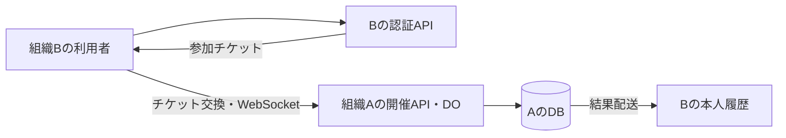
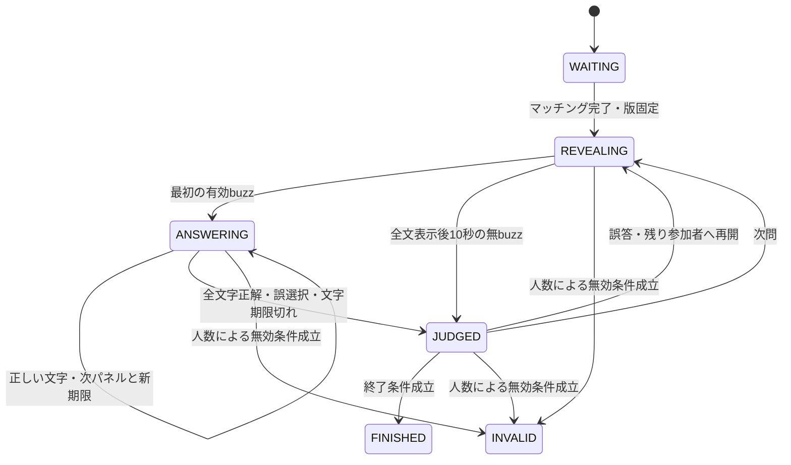

# 構成と対戦の復旧

[一覧](../README.md) ／ [対戦仕様](../spec/gameplay.md)

**開催インスタンスのDurable Objectが裁定し、確定結果をD1へ保存します。**
組織基盤・D1結果保存・別組織参加・宛先別配送を実装済みです。

## システム構成

| 層 | 役割 |
| --- | --- |
| React・TypeScript・Tailwind・Vite | 表示と入力。採点しない |
| Hono・Cloudflare Workers | 認証・認可・管理API・DBアクセス |
| Durable Objects・WebSocket | 早押し裁定・接続・期限など、試合中に変わる状態 |
| D1・SQLite・Drizzle | 問題・設定・部屋・試合の原本、確定結果と配送 |
| Clerk | 組織共通のGoogle認証 |
| Node.js | 開発・ビルド・テスト・CLI |

1配置で1組織を運営し、Worker・Auth・DBを共有します。インスタンスの追加に別デプロイは不要です。
通常アプリとローカル開発はD1です。結果配送・認証削除・完全削除・制御イベントは発生時に実行します。毎時Cronは失敗・残件の再試行と連合同期、日次Cronは保存期限・セッション・nonce・共有本文の消去と難易度集計を行います。設定と件数上限は[運用手順](../guides/operations.md)を参照してください。

CronはD1から対象を選び、非公開serviceへ依頼して完了を待ちます。1バッチで終わらない処理は自己service bindingで最大32回まで継続し、残りを毎時の再試行へ引き継ぎます。進捗・リースはD1に保存します。

Workersは常駐Nodeサーバーではなく、必要なAPIは nodejs_compat で検証します。
DB往復を早押しの裁定に挟まず、開始済み試合は取得済みの固定内容で進行します。

同組織内の参加には外部チケットを要求しません。組織間の通信は[プロトコル](protocol.md)に従います。

## 状態遷移

### カジュアルマッチと部屋の裁定

固定名`matchmaker`の1つのDOが、同じサーバー内で本人の参加枠を1つに制限します。ランク・カジュアル・部屋・出題専任を横断して判定し、参加中の新規要求には現在の部屋・インスタンス・モードを返します。別サーバーの参加枠とは同期しません。

部屋設定・入室順・部屋主・招待秘密・パスワードハッシュ・持込問題はD1に保存します。親DOは接続・準備完了・開始処理中の値を持ちます。開始操作は参加者と認可を再検証し、子の試合ID・固定定義・tokenを保存して初期化します。再送とAlarmは同じ試合IDを使います。

次試合は新しいUUIDの子で開始します。D1確定後、子がMatchmakerと親へ終了を通知し、親は参加者をロビーへ戻します。通知が失敗した間は子を保持し、再試行します。通知完了後、子はソケットを閉じ、ストレージとAlarmを削除します。

親DOは所属インスタンスのIDも保存します。D1の部屋が消えた場合は、そのIDの削除受付・完了記録とインスタンスの不存在を確認し、接続・ストレージ・Alarmを解放します。削除完了を確認できない行欠落はエラーにし、DOの状態を保持します。

取消RPCの呼出元は、対象が親ロビーか試合かを明示します。解放済みの親ロビーへの取消・失効は状態を再作成せず完了し、初期化前の試合への取消・失効は遅延した予約を拒否する記録を保持します。親ロビーの取消は更新直前にも世代・tokenを照合し、再入室後の接続や参加状態を古い要求で変更しません。子の状態確認後に親が別の試合へ進み、本人が参加者になっている場合も通常取消を拒否します。古い要求による子試合の失効は、その世代・tokenに対応するセッションだけに適用します。子試合が開始処理中などの理由で失効を拒否した場合は、親の参加・追跡記録を保持して未完了を返します。ログアウトも失効完了までは新規参加を止め、復旧後の再試行で完了させます。

開始中の固定要求と試合中の大きな状態はDOの値上限に合わせて分割保存します。部屋の恒久的な設定・持込原本はD1に置きます。

試合の失効済み記録だけではセッション削除の完了と判断しません。保存障害で対象tokenのセッションが残った場合は、再試行で削除を完了します。対象tokenの削除が済んでいれば、同じ失効要求の再送で復帰後の新tokenを失効させません。

持込の振り返りとゲスト名はD1で30日保持します。部屋を閉じる際はメンバー・秘密値・持込原本を消し、部屋DOも削除します。本人の保存セットは別に管理します。

- WAITING：自動マッチングの参加認証・接続・版取得を完了させて即開始。開始後の新規途中参加は不可、既存参加者は無効確定前に再接続可能。固定マッチング設定のplayersPerMatch人がそろったら開始。初期人数は4人。

  検証用・サーバー固有の人数をコンフィグからマッチング固定版へ保存する。
- REVEALING：表示済みの本文だけを配信。最初にDOが受け付けた有効buzzへ解答権を付与し、表示位置を凍結する。
- ANSWERING：actor、matchId、questionIdと版、解答権、締切を検証する。別接続から同じactorが送っても同じ権限として扱う。
- JUDGED：正解なら次問。誤答ならお手つきを1回加算し当該問題をロック、累計3回で失格として以後のbuzz・文字選択を拒否する。失格していない残りの参加者へ凍結位置から再開。全員ロック済みなら次問。

  以下の終了判定はランク用。部屋の終了条件は部屋仕様に従う。ただし7問先取ならFINISHEDへ進み、失格していない参加者が1人以下ならINVALIDへ進む。問題枯渇時はその時点の成績で判定してFINISHEDへ進む（未失格者の正解数が単独最多なら勝利、最多同数なら引き分け）。
- FINISHED：対戦操作を受理せず、結果保存と同期状態を返す。
- INVALID：人数条件で無効終了。理由と終了状態を永続化し、終了時の接続・失格状態に従いレートを一度だけ反映する。試合中の接続中actorが1人以下の状態が30秒続いた場合、または未失格者が1人以下になった場合に遷移する。

  後者は猶予なし。FINISHED後の通常切断では結果を無効化しない。

全文表示後10秒の無buzzは無得点終了、解答時間切れは誤答扱い。判定表示の初期値は2秒。

無効条件は接続中actorが1人以下、または失格していない参加者が1人以下で、接続人数不足には30秒の一時停止・復帰猶予を設け、未失格者不足には猶予を設けない。正解の公開は再開しないと決まった問題の終了後のみ。

誤答後に他プレイヤーの解答権が残る間は正解全文を配信しない。共有設定オンの試合では、回答者が実際に選んだ文字は正誤を問わず公開する。

## コマンドと復帰

コマンドは `commandId, matchId, questionId, type, payload` を持ち、actorは認証済み接続から取得する。自己申告時刻を信頼しない。

DO内の非同期処理の割り込みでも二重裁定しないよう、状態更新と重複排除を直列化する。

`(matchId, actorId, commandId)` で重複排除。同一ID・同一内容は保存済み応答、内容違いは競合として拒否する。ACK・公開イベントの前に裁定状態とコマンド結果をDOストレージへ永続化する。

公開イベントに単調増加roomSeqを付ける。再接続はlastSeqを送信し、保持範囲なら差分、範囲外ならsnapshotとそのroomSeqで復旧する。snapshot以後のイベントを欠落なく送る。

本文・得点・権利・締切・保存状態と、共有設定オンの場合だけ受理済みの選択文字を公開する。未選択の正解や非公開本文は含めない。差分は直近60秒かつ最大512件を保持する。

接続中actorが1人以下になった試合は30秒の猶予中に一時停止し、期限内の復帰なら再開、期限以後はINVALIDを返す。

締切はサーバー絶対時刻。`now >= deadline` を期限切れとする。タイマーだけでなくコマンド処理時にも検証し、タイマー遅延による期限後の解答を防ぐ。

解答者専用イベントで `attemptId, panelId, position, choices, deadline` を送る。

選択コマンドは既存のcommandId等に加えてattemptId・panelId・選択肢IDを含む。正解かどうかを示すフラグは送らない。

DOは権利・期限・現在パネルとの一致を検証し、同じ選択の再送で位置を二重に進めない。パネルは生成時の並びとIDを永続化し、再接続やDO復帰でも同じ状態を返す。誤選択はその時点で誤答として裁定し、次のパネルを出さない。

正しい文字なら次へ進み、最後まで正しければ正解とする。期限は現在パネルのサーバー有効化時刻＋固定characterAnswerTimeMs（初期値3000ms）とし、次の文字のパネル有効化時に新しい期限を設定する。

再送・再接続・DO復帰で同一パネルの期限を更新しない。古いパネルのタイマーが新しいパネルを誤答にしないよう、attemptId・panelIdと期限を照合する。誤選択・期限切れの競合でもお手つき加算と失格判定は1回だけ行う。

専用パネルを公開roomSeqイベントに混ぜない。公開snapshotに正答やパネルを含めず、認証した解答者本人へ現在のパネルと入力位置を別送する。共有設定がオンのときだけ、実際に受理した選択文字を公開する。未選択の正解を推測できる内部情報は配信しない。

## 接続人数と終了判定

接続数ではなく、認証済みの有効接続を少なくとも1本持つ参加actorの数を数える。同一actorのタブを閉じても他の有効接続があれば人数を減らさない。

当該問題の誤答ロックと試合中の失格は切断ではなく、接続中のactor数から除外しない。接続人数と失格していない参加者数は別々に数える。接続人数不足は30秒の猶予後、ランクの未失格者不足は即時にINVALIDにする。部屋の失格による最後の1人は勝者とする。

当該問題だけのロックで後者を減らさない。

開催元が切断を検知して人数を更新した処理内で、REVEALING / ANSWERING / JUDGEDかつ1人以下なら30秒の猶予期限と残り時間を永続化する。期限内の復帰がなければINVALIDを永続化する。

進行・採点・通常終了との競合はDOの裁定順で一意に解決し、一度INVALIDになった試合は復帰させない。2人対戦で片方の切断を検知すると一時停止し、30秒間復帰を待つ。

30秒の猶予は開催元の人数不足検知から数える。物理的な通信断を遅延ゼロで検知する保証ではない。close/errorと死活監視は5秒間隔・15秒無応答を初期値とし、検知待ちと再接続猶予を区別する。

Hibernationやメモリ再構築の途中を接続0人と誤判定せず、接続情報を復元してから判定する。再接続の検証は、他に2人以上残って進行を続ける場合と、人数不足で一時停止する場合の両方で行う。

ランクでは、失格を確定する裁定内で未失格者数を更新し、1人以下ならINVALIDを永続化する。部屋では失格による最後の1人を勝者にする。通常進行で残り1人の時点で終了するため全員失格まで進めず、復元時に全員失格の状態を検出した場合も無効とする。

判定順は、無効条件、7問先取、問題枯渇、同問再開または次問の順とし、一度確定した終端状態を後続イベントで変更しない。問題枯渇時も無効条件を優先する。

## クライアントの切断検知

WebSocket確立・初回状態の待機は10秒、有効なstate/deltaを受信した後は15秒の受信監視へ切り替える。状態受信ごとに監視期限を更新し、ACK・エラーだけでは延長しない。

無応答時は古い接続を切り離し、closeイベントの到着を待たず再接続する。古い接続から遅れて届くイベントは無視する。

再接続は1.5秒間隔を維持し、連続5回の上限を撤廃。クライアントが最初の切断・接続失敗を検知してから30秒を上限に試行する。接続が開いただけでは上限をリセットせず、有効な状態の受信で復旧と判定する。

30秒で接続中の試行も停止し、手動再接続を案内する。1008のポリシー拒否は即時停止を維持する。

この30秒はクライアントの自動再試行の上限で、サーバーの人数不足による復帰猶予とは検知時刻が異なり得る。試合再開の可否はサーバーの期限・状態を正とし、クライアントから延長しない。待機中・初回接続も同じ再試行方針を使う。

## Durable Objectの永続化

状態、固定版、使用問題、表示位置、解答権、解答試行とパネル・選択位置、ロック集合、正解数・累計お手つき数・失格状態、締切、接続人数判定に必要な情報、得点、裁定記録、roomSeq、重複排除情報、未保存結果・無効終了理由を保持する。

Hibernation復帰では永続状態と接続情報から再構築し、期限を再評価する。

出題中の細かい配信は活動中に行う。休止中のsetInterval継続を前提とせず、絶対時刻とAlarmで復帰する。複数の期限と結果再試行は、最も近い予定をAlarmへ設定し、復帰時に残りを再設定する。

Alarmの再実行でも処理は冪等にする。

[WebSocket Hibernation公式資料](https://developers.cloudflare.com/durable-objects/best-practices/websockets/)参照。

長時間停止を一気に追いつかせて問題を読み飛ばさない復旧方針を採用する（2026-09-11）。復帰時に期限切れの現在状態を一度処理し、次の表示開始時刻を設定する。停止中の不利を含め、試合成立条件で評価する。

## 固定版の取得と待機列

worker/catalogがD1から不変のマッチング設定・ルール・問題セットと停止状態を読み、内容hashと候補等を検証する。game/stateは検証済み定義を受け取り、問題・ルール・識別子を複製して固定できる。

正式参加ではMatchmaker DOが認証済みactorの予約を直列化し、GameRoom DOが定員・取消・接続完了を直列化する。待機時の版が開始直前もDBに存在し、ルールhash・人数が一致することを確認する。DB停止・版の不一致なら開始しない。問題の停止は確認せず、固定した問題で開始する。

開始済み試合はDO保存済みデータを維持する。[検証項目](../development/testing.md)。

人数・ルール・問題セットはJSONを入力にDBの不変版へ反映し、有効プロファイルを切り替える。新規マッチングは有効版を毎回DBから読み、マッチング定義版ごとに待機列を分ける。

開始前検証は待機時に保存した版を明示して読み、設定変更で既存部屋の人数・ルールを変えない。復帰も既存版を維持する。運用上の監視時間・待機期限・上限はconfig/runtime.jsonに置く。

詳細は[設定手順](../guides/configuration.md)。

catalogの読込・設定反映、初期seed、probeのDB操作はDrizzleで行う。DB読込は順序付きJOINを使い、読込前後のD1 revisionが一致した同一世代の情報だけを採用する。

JSONの有効化は問題検証・版追加/再利用・有効参照の更新を、revision照合付きのD1 batchで一括保存する。migrationもDrizzle Kitで管理する。既存形式の移行は行わず、検証用D1・DOはバックアップ後に再構築します。

[DB管理](../guides/database.md)参照。

MatchmakerのDB読込をblockConcurrencyWhileの外へ移動した。読込前にリクエスト回数と読込識別子を保存し、読込後は待機列・参加状況・定員を再取得して予約する。

DB待ち中も他actorの取消・復帰・Alarmを処理する。同一actorの後発要求や取消で失効した読込結果は予約へ使わない。DB障害は503へ変換し、既存予約は保持する。
候補登録・閲覧先の変更・画面移動は参加と接続の寿命から分離します。部屋未確定の参加も要求時の操作ID・接続先を保持し、遅い成功応答でその先へ接続します。本人の取消時には部屋未確定の操作IDにも閉鎖記録を保存し、参加要求の初回判定とDB読込後の割当判定の両方で拒否します。割当済みの待機は対象世代だけを取り消し、応答不明ならAlarmで再試行します。閉鎖済みの旧参加を切替失敗で復元しません。閉鎖記録は既存の12時間の操作記録期間で保持します。
自動マッチの初回接続後は、最後の接続切れの検知処理で待機を除外します。別タブが接続中なら残し、開始済みなら結果を作らず取り消す処理は行いません。予約台帳に切断前の記録が残る間も、裁定DOの在席と新しい予約を照合して空き枠を計算します。

## 結果の保存と再試行

自動マッチと入室は操作ID・要求hash・世代を固定します。参加中の新規要求はALREADY_JOINEDまたはOTHER_INSTANCE_ACTIVEで拒否し、「参加中へ戻る」「離脱して参加する」を表示します。離脱を選んだ場合は取消完了後に新規参加します。
進行中の離脱は裁定DOで本人のforfeited・失格・切断を固定し、他の参加者の成績を変えません。終端後の離脱・再接続では固定済み結果を変更しません。開始前の取消は結果を生成しません。

1. 待機時にUUIDの試合IDでD1の試合行を作り、開始時にrunningへ更新する。開始更新と同じD1処理で非公開化・削除受付を検査し、該当する場合は開始を拒否する。開始済みの同一要求は再送できる。削除側も、関連データと原本の各消去処理内でrunningがないことを再検査する。
2. 終了時にDOの裁定結果をD1へ保存し、同じbatchで参加者差分・outboxを確定する。
3. 確定後に終了を通知し、クライアントはD1の結果を取得する。通知完了後はDOを削除する。
4. 同じ試合ID・hashの再送は成功とする。異なるhashは原本を上書きせずconflictにし、通常履歴と順位から除外する。

DB待機はDOの直列化区間外で行います。DB停止中は「保存中」を維持し、Alarmで再試行します。
開始・取消の再試行で試合行が見つからない場合は、同じ開催元の削除受付・完了証跡とインスタンス本体の不在を同じD1読取で確認します。削除完了を確認できた試合は取消済みとして終了通知へ進み、通知後にDOとAlarmを解放します。削除証跡のない行欠落やDB障害は成功扱いにしません。
DOとDBに分散トランザクションはありません。終端確定とDB保存の完了を区別し、レート・集計はDBへ保存した結果だけに加算します。
宛先別outbox・署名イベント・受領処理を実装しています。受領・履歴反映・匿名化完了を区別し、未完了は定期処理で再試行します。

## 配置・更新・復旧

今回は現行のCloudflare Workers・Durable Objects・D1とClerkの構成で制作します。
Cloudflare標準URLと任意の独自ドメインの両方で運用できるようにします。独自ドメインの取得は必須にしません。
Cloudflare非依存化は将来タスクです。実施時に対戦の状態管理・WebSocket・永続化・タイマー処理と既存データの移行を設計します。Docker Composeなどの設置方式も将来検討とし、現行制作の前提を増やしません。
アプリのrollbackだけでDBは元に戻りません。DB・DO未保存結果・設定・鍵履歴を復旧対象とし、変更前に互換性と復元手順を検証します。
DB・設定・鍵履歴のバックアップは毎日取得し、30日保持します。DOの未保存結果も復旧対象に含めます。
目標は最大24時間分のデータ損失（RPO24時間）・24時間以内の復旧（RTO24時間）です。実測済みの保証値ではなく、復旧試験で検証する設計目標です。
削除記録を復元時にも適用し、退会・完全削除で消したデータを復活させません。

無料枠での運営を保証せず、容量・保存量・接続数を確認します。現在の[実装・検証状況](../development/testing.md#d1-clerk)と、実行可能な[環境手順](../guides/setup.md)を参照してください。

## 開始と設定変更の競合

**ランク・カジュアルマッチの設定と問題は、待機部屋の作成時に固定します。開始調整用のDOは置きません。**
Matchmakerは参加時に有効な大会版をD1から読み、待機列を大会版ごとに分けます。GameRoomは最初の予約で候補全体と出題順を固定し、後から入る参加者も同じ内容を使います。
人数・ルール・出題設定の変更と問題の追加・改訂・停止は、次に作られる待機部屋から反映します。開始直前の検証は固定した版の存在・ルールhash・人数だけを確認し、問題の停止や共有問題の利用可否では開始を止めません。
開始はGameRoomの直列化区間で `WAITING` から一度だけ移り、同じ試合の開始再送を二重開始にしません。
候補0は参加時と明示的な設定変更時に検出します。次の参加時に候補があれば受け付け、解除した待機者を自動再参加させません。

## 部屋の開始・終端

入退室・部屋設定・部屋主はD1に保存し、定員は条件付き挿入で守ります。期限切れメンバーを読取時に除外し、一覧はD1だけで人数と部屋主名を返します。接続・準備・開始中の競合は親DOで裁定します。
同じ回答者の多重接続で人数を増やしません。入室者は回答者枠8人と専任枠1人の範囲内で保持します。
終端は1回だけ確定します。通常は最後の未失格者が勝利し、全員失格という異常状態で未確定のままならINVALIDにします。確定後の切断や遅延コマンドで勝敗を変えません。
D1の保存完了通知を受けてからロビーへ戻り、次の試合を開始します。確定結果はD1だけから復元できます。

## 運営への障害表示

DB保存待ち・宛先別配送待ちが5分を超えた場合、または隔離データが1件以上ある場合に運営へ警告します。通常ユーザーへ非公開原本を表示しません。
バックアップは日次に加えてmigration適用・破壊的な設定変更の前にも取得します。復旧試験は隔離環境で行い、DB・DO未保存結果・鍵履歴・設定・削除記録をまとめて回復できることを検証します。これらの設計は未実装・未検証であり、本番障害試験や新規有料契約を実行する指示ではありません。
